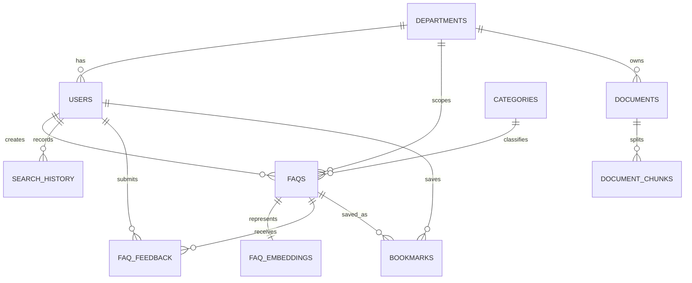

# CampusQuery — College FAQ Intelligence System

CampusQuery is a DBMS Level 3 experiential-learning project that turns a student's natural-language question into grounded university information. It is intentionally not a generic chatbot: every result comes from the stored FAQ/document knowledge base and shows its source, category, department, update date, and relevance.

## Problem and objectives

University information is distributed across regulations, notices, department pages, and service handbooks. CampusQuery gives students one trustworthy discovery surface while giving administrators an auditable knowledge-management and analytics surface.

The primary contribution is:

**Natural-language question → PostgreSQL keyword search + pgvector semantic retrieval → structured filters → ranked, source-aware answer.**

## Features

- Student desk with natural-language question entry and suggested questions
- Hybrid retrieval using PostgreSQL full-text search and pgvector cosine similarity
- Category and department filtering, plus relevance/view/update sorting
- FAQ detail with source metadata, related questions, bookmark, and feedback
- Search history and saved answers
- Admin dashboard with totals, category/department counts, recent and low-feedback FAQs
- FAQ publishing form and a safe `/admin/database-demo` explanation surface
- Database constraints, indexes, views, stored function, trigger, and seed dataset
- Responsive interface with loading, empty, error, and confirmation states

## Technology stack

- React + Vite frontend in `artifacts/campus-query`
- Express API service in `artifacts/api-server`
- PostgreSQL with `pgvector`
- Drizzle workspace database package and parameterized `pg` queries
- OpenAPI-first contract with Orval-generated React Query hooks and Zod schemas

## Architecture

```text
Student/Admin UI
      |
      v
Express API (/api)
      |
      +--> PostgreSQL relational tables
      |       + constraints, joins, aggregates, views, triggers
      |
      +--> faq_embeddings / document_chunks (pgvector)
              + cosine similarity
      |
      v
      Hybrid ranking + filters + source metadata
```

PostgreSQL is required for users, roles, departments, categories, FAQ metadata, feedback, bookmarks, history, joins, aggregates, integrity constraints, views, triggers, and transactions. pgvector is required for meaning-based matching when the words in a student's question differ from the stored FAQ wording.

## Relational model and ER diagram



The schema is normalized around independent users, departments, categories, FAQs, documents, interactions, and vector representations. Foreign keys define cardinality, unique constraints prevent duplicate identities/bookmarks, and CHECK constraints protect role/status/rating/priority domains.

## Advanced database concepts

1. **Transactions** — FAQ publishing and future document chunk/embedding writes are designed as atomic multi-row operations.
2. **Views** — `popular_faqs_view`, `unanswered_or_low_feedback_faqs_view`, and `department_faq_statistics_view` drive admin insights.
3. **Stored function** — `get_faq_statistics(department_id)` returns counts, average rating, and views.
4. **Triggers** — `touch_updated_at()` updates FAQ/document timestamps on modification.
5. **Indexing** — foreign-key/filter indexes, GIN full-text index, and HNSW vector index.
6. **Full-text search** — generated `tsvector` column with English stemming and GIN indexing.
7. **Vector search** — `faq_embeddings.embedding <=> query_vector` provides cosine-distance semantic ranking.

## Embeddings and retrieval

The schema stores a vector and its `embedding_model` for each FAQ. The development seed uses an explicit deterministic fallback embedding so the demonstration works without a provider credential. A production embedding adapter can replace this fallback and use a configurable model/API key from environment variables.

Search combines `ts_rank` from `search_vector` with `1 - cosine_distance` from pgvector. Results are then constrained by published status and optional department/category filters. This keeps semantic retrieval useful without sacrificing the structured database behavior required by the project.

## API

| Method | Route | Purpose |
| --- | --- | --- |
| GET | `/api/auth/session` | Demo Student/Admin session |
| GET | `/api/search` | Hybrid FAQ search |
| GET | `/api/faqs`, `/api/faqs/:id` | Browse and inspect FAQs |
| GET/POST | `/api/bookmarks` | List/create bookmarks |
| DELETE | `/api/bookmarks/:faqId` | Remove bookmark |
| POST | `/api/feedback` | Rate an answer |
| GET | `/api/search/history` | Recent searches |
| GET | `/api/admin/summary` | Dashboard analytics |
| POST | `/api/admin/faqs` | Publish a FAQ |
| GET | `/api/admin/database-demo` | Safe DBMS concept examples |

## Setup

1. Provision PostgreSQL and copy `.env.example` to `.env`.
2. Run the DDL in `database/schema.sql`.
3. Run the demo data in `database/seed.sql`.
4. Install packages with `pnpm install`.
5. Start the managed API and web workflows.

The workspace scripts also expose `pnpm run typecheck` and `pnpm run build`. Generated client/Zod files are regenerated with:

```bash
pnpm --filter @workspace/api-spec run codegen
```

## Demo data

The seed includes 3 departments, 5 categories, 2 student users, 1 admin user, 8 FAQs, document records, embeddings, feedback, bookmarks, and search history. All content is explicitly demo/sample university policy and must not be presented as an actual institution's policy.

## Security notes

- Queries use parameterized PostgreSQL values.
- Database credentials and provider keys belong in environment variables, never source control.
- Passwords are not stored by this demo session; production authentication should use Clerk or Replit Auth with secure sessions and backend role checks.
- The admin surface is a separate role-aware product path; production deployments must enforce the role in server middleware, not only in navigation.

## Future enhancements

Connect a managed auth provider, add App Storage-backed PDF ingestion, chunk and embed documents during a transaction, add provider-backed embeddings, and expand the automated route/constraint test suite.