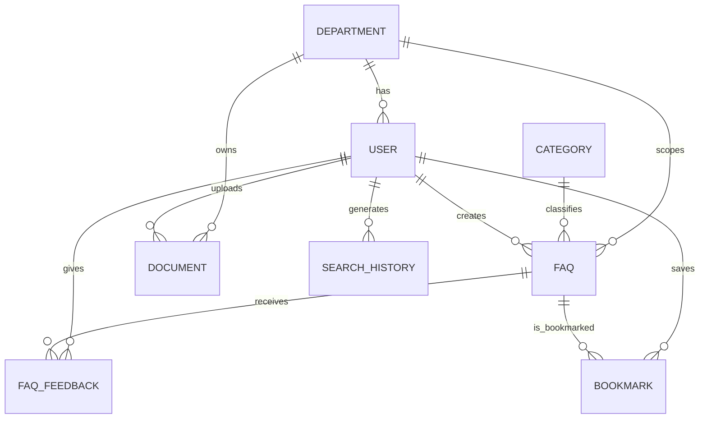

# CampusQuery: College FAQ Intelligence System

CampusQuery lets students ask university questions in natural language and get grounded answers from stored FAQs and documents. Every result shows its source, category, department and update date. An admin area manages FAQs and shows how the databases are used.

The system is a **hybrid of MySQL and MongoDB**:

| Store | Holds | Why |
| --- | --- | --- |
| **MySQL** | `DEPARTMENT`, `USER`, `CATEGORY`, `FAQ`, `DOCUMENT` (metadata), `FAQ_FEEDBACK`, `BOOKMARK`, `SEARCH_HISTORY` | Structured, relational data with keys, constraints, joins, aggregates, views, a trigger, a stored procedure and transactions |
| **MongoDB** | `knowledge_documents`, `document_chunks`, `faq_enrichment` | Flexible, unstructured knowledge: document content, tags, rules and requirements whose shape varies per document, passage chunks, and per-FAQ keywords |

## Architecture

```text
Student / Admin UI (React + Vite)
          |
          v
   Express API (/api)
          |
   +------+------------------------------+
   |                                     |
   v                                     v
MySQL (source of truth)            MongoDB (knowledge)
 FAQ, USER, CATEGORY, ...           knowledge_documents  (text index)
 FULLTEXT(question, answer)         document_chunks      (text index)
 views, trigger, procedure          faq_enrichment       (text index)
   |                                     |
   +------------- hybrid ranking --------+
                       |
                       v
     ranked FAQs + matching knowledge documents
```

### Hybrid retrieval

For a search such as `dorm visitors`:

1. **MongoDB**: `faq_enrichment` (tags and keywords) is text-searched to produce a per-FAQ boost, and `knowledge_documents` and `document_chunks` are text-searched for matching documents and snippets.
2. **MySQL**: `FAQ` is filtered by `status = 'PUBLISHED'`, department and category, and matched by an InnoDB `FULLTEXT` score, or by a FAQ id that MongoDB boosted.
3. **Ranking**: `relevance = 0.7 * normalized_fulltext_score + 0.3 * mongo_tag_boost`, then sorted by relevance, views or recency.
4. The response contains the ranked FAQs plus `knowledgeDocuments` (document title, source, tags and the best-matching snippet).

If MongoDB is unreachable the API logs a warning and returns MySQL-only results.

### How the two databases are linked

- `DOCUMENT.file_reference` holds `knowledge_documents/<document_id>`, and each Mongo document stores `mysql_document_id`.
- `faq_enrichment.faq_id` references `FAQ.faq_id`, and `related_document_ids` lists linked Mongo documents.
- MySQL is the source of truth. There is no distributed transaction. When an admin publishes a FAQ, MySQL commits first (inside `sp_publish_faq`) and the Mongo enrichment is written afterwards. Enrichment can be rebuilt, so a Mongo failure never loses a FAQ.

## Relational model (MySQL)



`DOCUMENT_CHUNK` is no longer a relational table. Passage text and its JSON metadata are stored in the MongoDB `document_chunks` collection (a natural fit for variable metadata such as section and page).

## Document model (MongoDB)

| Collection | Shape | Indexes |
| --- | --- | --- |
| `knowledge_documents` | `document_id`, `mysql_document_id`, `title`, `department`, `document_type`, `content`, `tags[]`, `source`, plus optional `rules[]`, `requirements[]` or `steps[]` | unique `document_id`, unique `mysql_document_id`, `department`, `tags`, weighted text index on title, tags and content |
| `document_chunks` | `document_id`, `chunk_index`, `chunk_text`, `metadata{}` | unique `(document_id, chunk_index)`, text index on `chunk_text` |
| `faq_enrichment` | `faq_id`, `tags[]`, `keywords[]`, `related_document_ids[]` | unique `faq_id`, weighted text index on keywords and tags |

Collections have `$jsonSchema` validators for their core fields; everything else stays flexible.

## Database concepts demonstrated

**MySQL**: primary and foreign keys with `ON DELETE` / `ON UPDATE` rules, `UNIQUE` and `CHECK` constraints, secondary indexes, an InnoDB `FULLTEXT` index, `ALTER TABLE`, three views (`popular_faqs_view`, `department_faq_statistics`, `low_feedback_faqs_view`), a stored function (`fn_faq_average_rating`), stored procedures (`sp_publish_faq` with a transaction and rollback handler, `sp_department_statistics`) and a trigger (`trg_bookmark_only_published`).

**MongoDB**: document model, `$jsonSchema` validation, unique, multikey and compound indexes, weighted text indexes, `$text` search with `textScore` ranking, `$in` lookups and upserts.

## Setup

Requirements: Node.js 24, pnpm, MySQL 8+, MongoDB 6+.

```bash
# 1. MySQL: creates the CampusQuery database, tables, indexes, views, routines, trigger
mysql -u root -p < database/mysql/schema.sql
mysql -u root -p CampusQuery < database/mysql/seed.sql

# 2. MongoDB: collections, validators, seed documents, indexes
mongosh "mongodb://localhost:27017" database/mongodb/init.js

# 3. Environment
cp .env.example .env    # set MYSQL_URL, MONGODB_URI, MONGODB_DB

# 4. Run
pnpm install
PORT=5000 pnpm --filter @workspace/api-server run dev
PORT=5173 BASE_PATH=/ API_URL=http://localhost:5000 pnpm --filter @workspace/campus-query run dev
```

The Vite dev server proxies `/api` requests to `API_URL` (defaults to `http://localhost:5000`). Keep the API server running while using the frontend; otherwise API requests will fail.

Other scripts: `pnpm run typecheck`, `pnpm run build`, and `pnpm --filter @workspace/api-spec run codegen` (regenerates the API client and Zod schemas after editing `lib/api-spec/openapi.yaml`).

### Useful queries to show in a demo

```sql
SELECT * FROM popular_faqs_view ORDER BY view_count DESC;
CALL sp_department_statistics(NULL);
SELECT faq_id, MATCH(question, answer) AGAINST ('attendance' IN NATURAL LANGUAGE MODE) AS score
FROM FAQ HAVING score > 0 ORDER BY score DESC;
```

```js
db.knowledge_documents.find({ tags: "hostel" })
db.knowledge_documents.find({ $text: { $search: "attendance" } }, { title: 1, score: { $meta: "textScore" } }).sort({ score: { $meta: "textScore" } })
db.faq_enrichment.find({ faq_id: 6 })
```

## API

| Method | Route | Purpose |
| --- | --- | --- |
| GET | `/api/auth/session` | Demo Student/Admin session (`x-demo-role` header) |
| GET | `/api/search` | Hybrid search: ranked FAQs plus `knowledgeDocuments` |
| GET | `/api/faqs`, `/api/faqs/:id` | Browse FAQs; detail includes related FAQs and supporting documents |
| GET/POST | `/api/bookmarks` | List / create bookmarks |
| DELETE | `/api/bookmarks/:faqId` | Remove a bookmark |
| POST | `/api/feedback` | Rate an answer (one rating per user per FAQ, updated on repeat) |
| GET | `/api/search/history` | Recent searches |
| GET | `/api/admin/summary` | Dashboard analytics |
| POST | `/api/admin/faqs` | Publish a FAQ (`sp_publish_faq` + Mongo enrichment) |
| GET | `/api/admin/database-demo` | Live MySQL and MongoDB concept demo |

## Notes

- All seed content is sample data and not any institution's real policy.
- `password_hash` values in the seed are placeholders. The demo session does not use passwords; real deployments need proper authentication and server-side role checks.
- All SQL uses parameterized values. Credentials belong in environment variables.
- Statuses are stored upper-case in MySQL (`PUBLISHED`, `DRAFT`, `ARCHIVED`) and exposed lower-case by the API.
